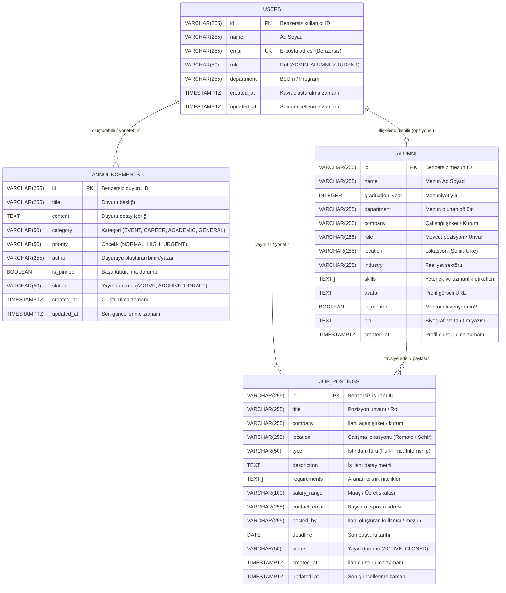

# Data Definition Document (DDD) - Veritabanı Şeması ve Tablo Dokümantasyonu

Bu doküman, **Alumni Tracking System (AlumniSphere)** projesinin ilişkisel veritabanı (PostgreSQL) mimarisini, tablo tanımlarını, veri tiplerini, kısıtlamalarını (constraints) ve ilişkilerini detaylandırmaktadır.

---

## 🏛️ Varlık İlişki Diyagramı (Entity Relationship Diagram - ERD)

Aşağıdaki Mermaid diyagramı sistemdeki ana veri varlıklarını ve alanlarını göstermektedir:



---

## 📋 Veritabanı Tabloları (Database Tables)

### 1. `users` Tablosu
Sistemdeki kullanıcı hesaplarını, rollerini ve temel profil bilgilerini saklar.

| Alan Adı (Column) | Veri Tipi (Type) | Zorunlu (Nullable) | Varsayılan (Default) | Açıklama |
| :--- | :--- | :--- | :--- | :--- |
| `id` | `VARCHAR(255)` | **HAYIR** (PK) | — | Kullanıcının benzersiz kimliği (Primary Key) |
| `name` | `VARCHAR(255)` | **HAYIR** | — | Kullanıcının tam adı ve soyadı |
| `email` | `VARCHAR(255)` | **HAYIR** (UNIQUE) | — | Kullanıcının tekil e-posta adresi |
| `role` | `VARCHAR(50)` | EVET | `'STUDENT'` | Kullanıcı rolü: `ADMIN`, `ALUMNI`, `STUDENT` |
| `department` | `VARCHAR(255)` | EVET | `'Belirtilmedi'` | Kullanıcının okuduğu/mezun olduğu akademik bölüm |
| `created_at` | `TIMESTAMPTZ` | EVET | `NOW()` | Kullanıcı kaydının oluşturulduğu zaman damgası |
| `updated_at` | `TIMESTAMPTZ` | EVET | `NOW()` | Kullanıcı kaydının son güncellendiği zaman damgası |

#### Örnek Kayıt:
```json
{
  "id": "1",
  "name": "Eren Kılıç",
  "email": "eren@alumni.edu",
  "role": "ADMIN",
  "department": "Software Engineering",
  "created_at": "2026-10-13T06:29:53.526Z",
  "updated_at": "2026-10-13T06:29:53.526Z"
}
```

---

### 2. `announcements` Tablosu
Üniversite, kariyer merkezi veya mezunlar ofisi tarafından yayınlanan etkinlik, iş ilanı ve akademik duyuruları saklar.

| Alan Adı (Column) | Veri Tipi (Type) | Zorunlu (Nullable) | Varsayılan (Default) | Açıklama |
| :--- | :--- | :--- | :--- | :--- |
| `id` | `VARCHAR(255)` | **HAYIR** (PK) | — | Duyurunun benzersiz kimliği (Primary Key) |
| `title` | `VARCHAR(255)` | **HAYIR** | — | Duyurunun başlığı |
| `content` | `TEXT` | **HAYIR** | — | Duyurunun detaylı metin içeriği |
| `category` | `VARCHAR(50)` | EVET | `'GENERAL'` | Kategori: `EVENT`, `CAREER`, `ACADEMIC`, `GENERAL` |
| `priority` | `VARCHAR(50)` | EVET | `'NORMAL'` | Öncelik derecesi: `NORMAL`, `HIGH`, `URGENT` |
| `author` | `VARCHAR(255)` | EVET | `'Alumni Staff'` | Duyuruyu yayınlayan birim veya kişi |
| `is_pinned` | `BOOLEAN` | EVET | `FALSE` | Panoda en üste sabitlenmiş duyuru mu? |
| `status` | `VARCHAR(50)` | EVET | `'ACTIVE'` | Durum: `ACTIVE`, `ARCHIVED`, `DRAFT` |
| `created_at` | `TIMESTAMPTZ` | EVET | `NOW()` | Duyuru yayın zamanı |
| `updated_at` | `TIMESTAMPTZ` | EVET | `NOW()` | Duyuru son güncelleme zamanı |

#### Örnek Kayıt:
```json
{
  "id": "1",
  "title": "Annual Alumni Homecoming Weekend 2026",
  "content": "Join us this October for the annual Homecoming Reunion! Connect with fellow graduates...",
  "category": "EVENT",
  "priority": "HIGH",
  "author": "Alumni Relations Office",
  "is_pinned": true,
  "status": "ACTIVE",
  "created_at": "2026-10-14T06:33:33.331Z",
  "updated_at": "2026-10-14T06:33:33.331Z"
}
```

---

### 3. `alumni` Tablosu
Mezunların mesleki deneyimlerini, çalıştıkları sektörleri, uzmanlık alanlarını ve mentorluk durumlarını saklar.

| Alan Adı (Column) | Veri Tipi (Type) | Zorunlu (Nullable) | Varsayılan (Default) | Açıklama |
| :--- | :--- | :--- | :--- | :--- |
| `id` | `VARCHAR(255)` | **HAYIR** (PK) | — | Mezun profilinin benzersiz kimliği (Primary Key) |
| `name` | `VARCHAR(255)` | **HAYIR** | — | Mezunun adı soyadı |
| `graduation_year`| `INTEGER` | **HAYIR** | — | Üniversiteden mezun olduğu yıl (Örn: 2021) |
| `department` | `VARCHAR(255)` | **HAYIR** | — | Mezun olduğu fakülte/bölüm |
| `company` | `VARCHAR(255)` | EVET | `'Freelance / Independent'` | Mevcut çalıştığı kurum / şirket |
| `role` | `VARCHAR(255)` | EVET | `'Specialist'` | İş unvanı (Örn: Senior Software Engineer) |
| `location` | `VARCHAR(255)` | EVET | `'Remote'` | Yaşadığı / çalıştığı şehir veya ülke |
| `industry` | `VARCHAR(255)` | EVET | `'Technology'` | Faaliyet gösterdiği ana sektör |
| `skills` | `TEXT[]` | EVET | `'{}'` | Yetenek etiketleri dizisi (PostgreSQL Array) |
| `avatar` | `TEXT` | EVET | — | Profil fotoğrafı URL adresi |
| `is_mentor` | `BOOLEAN` | EVET | `FALSE` | Öğrencilere mentorluk yapmaya açık mı? |
| `bio` | `TEXT` | EVET | — | Kısa biyografi ve mezun açıklaması |
| `created_at` | `TIMESTAMPTZ` | EVET | `NOW()` | Profilin veritabanına eklenme tarihi |

#### Örnek Kayıt:
```json
{
  "id": "1",
  "name": "Hakan Tosun",
  "graduation_year": 2021,
  "department": "Computer Engineering",
  "company": "Google",
  "role": "Senior Software Engineer",
  "location": "Zurich, Switzerland",
  "industry": "Technology",
  "skills": ["Go", "Kubernetes", "Distributed Systems", "Cloud"],
  "avatar": "https://images.unsplash.com/photo-1494790108377-be9c29b29330?w=150&auto=format&fit=crop&q=80",
  "is_mentor": true,
  "bio": "Graduated with honors in 2021. Open for student mentorship in cloud infrastructure.",
  "created_at": "2026-10-14T06:33:33.333Z"
}
```

---

### 4. `job_postings` Tablosu
Üniversite mezunları, kariyer geliştirme merkezi ve iş ortakları tarafından paylaşılan kariyer fırsatlarını, iş ve staj ilanlarını saklar.

| Alan Adı (Column) | Veri Tipi (Type) | Zorunlu (Nullable) | Varsayılan (Default) | Açıklama |
| :--- | :--- | :--- | :--- | :--- |
| `id` | `VARCHAR(255)` | **HAYIR** (PK) | — | İş ilanının benzersiz kimliği (Primary Key) |
| `title` | `VARCHAR(255)` | **HAYIR** | — | Pozisyon veya staj unvanı (Örn: Junior Backend Developer) |
| `company` | `VARCHAR(255)` | **HAYIR** | — | İlanı yayınlayan şirket veya kuruluş |
| `location` | `VARCHAR(255)` | EVET | `'Remote'` | Çalışma yeri / modeli (Örn: Remote / Istanbul, Hybrid) |
| `type` | `VARCHAR(50)` | EVET | `'Full-Time'` | İstihdam türü: `Full-Time`, `Part-Time`, `Internship`, `Contract` |
| `description` | `TEXT` | **HAYIR** | — | İlanın kapsamlı iş tanımı, sorumlulukları ve detayları |
| `requirements` | `TEXT[]` | EVET | `'{}'` | Aranan nitelikler, teknik beceriler ve teknoloji etiketleri |
| `salary_range` | `VARCHAR(100)` | EVET | — | Maaş veya ücret aralığı (Örn: $40,000 - $55,000) |
| `contact_email`| `VARCHAR(255)` | EVET | — | Başvuru ve CV iletimi için iletişim e-posta adresi |
| `posted_by` | `VARCHAR(255)` | EVET | `'Alumni Career Network'` | İlanı sisteme ekleyen mezun/yetkili adı veya kimliği |
| `deadline` | `DATE` | EVET | — | Son başvuru tarihi (Örn: 2026-10-15) |
| `status` | `VARCHAR(50)` | EVET | `'ACTIVE'` | İlan yayın durumu: `ACTIVE`, `CLOSED`, `DRAFT` |
| `created_at` | `TIMESTAMPTZ` | EVET | `NOW()` | İlanın sisteme girildiği tarih ve saat |
| `updated_at` | `TIMESTAMPTZ` | EVET | `NOW()` | İlanın son güncellendiği tarih ve saat |

#### Örnek Kayıt:
```json
{
  "id": "job-1",
  "title": "Junior Backend Developer (Node.js / PostgreSQL)",
  "company": "Peak Tech",
  "location": "Remote / Istanbul",
  "type": "Full-Time",
  "description": "We are seeking a junior backend engineer to join our high-growth platform team working on scalable REST APIs and PostgreSQL databases.",
  "requirements": ["Node.js", "PostgreSQL", "Express", "Docker", "Git"],
  "salary_range": "$40,000 - $55,000",
  "contact_email": "careers@peaktech.example.com",
  "posted_by": "Burak Demir",
  "deadline": "2026-10-15",
  "status": "ACTIVE",
  "created_at": "2026-10-14T06:33:33.335Z",
  "updated_at": "2026-10-14T06:33:33.335Z"
}
```

---

## 🛠️ DDL (Data Definition Language) SQL Tanımları

PostgreSQL veritabanı başlatıldığında [server/src/db.js](file:///Users/erenkilic/repo/Alumni/server/src/db.js) tarafından otomatik olarak yürütülen SQL şeması:

```sql
-- 1. Users Tablosu
CREATE TABLE IF NOT EXISTS users (
  id VARCHAR(255) PRIMARY KEY,
  name VARCHAR(255) NOT NULL,
  email VARCHAR(255) NOT NULL UNIQUE,
  role VARCHAR(50) DEFAULT 'STUDENT',
  department VARCHAR(255) DEFAULT 'Belirtilmedi',
  created_at TIMESTAMPTZ DEFAULT NOW(),
  updated_at TIMESTAMPTZ DEFAULT NOW()
);

-- 2. Announcements Tablosu
CREATE TABLE IF NOT EXISTS announcements (
  id VARCHAR(255) PRIMARY KEY,
  title VARCHAR(255) NOT NULL,
  content TEXT NOT NULL,
  category VARCHAR(50) DEFAULT 'GENERAL',
  priority VARCHAR(50) DEFAULT 'NORMAL',
  author VARCHAR(255) DEFAULT 'Alumni Staff',
  is_pinned BOOLEAN DEFAULT FALSE,
  status VARCHAR(50) DEFAULT 'ACTIVE',
  created_at TIMESTAMPTZ DEFAULT NOW(),
  updated_at TIMESTAMPTZ DEFAULT NOW()
);

-- 3. Alumni Tablosu
CREATE TABLE IF NOT EXISTS alumni (
  id VARCHAR(255) PRIMARY KEY,
  name VARCHAR(255) NOT NULL,
  graduation_year INTEGER NOT NULL,
  department VARCHAR(255) NOT NULL,
  company VARCHAR(255) DEFAULT 'Freelance / Independent',
  role VARCHAR(255) DEFAULT 'Specialist',
  location VARCHAR(255) DEFAULT 'Remote',
  industry VARCHAR(255) DEFAULT 'Technology',
  skills TEXT[] DEFAULT '{}',
  avatar TEXT,
  is_mentor BOOLEAN DEFAULT FALSE,
  bio TEXT,
  created_at TIMESTAMPTZ DEFAULT NOW()
);

-- 4. Job Postings Tablosu
CREATE TABLE IF NOT EXISTS job_postings (
  id VARCHAR(255) PRIMARY KEY,
  title VARCHAR(255) NOT NULL,
  company VARCHAR(255) NOT NULL,
  location VARCHAR(255) DEFAULT 'Remote',
  type VARCHAR(50) DEFAULT 'Full-Time',
  description TEXT NOT NULL,
  requirements TEXT[] DEFAULT '{}',
  salary_range VARCHAR(100),
  contact_email VARCHAR(255),
  posted_by VARCHAR(255) DEFAULT 'Alumni Career Network',
  deadline DATE,
  status VARCHAR(50) DEFAULT 'ACTIVE',
  created_at TIMESTAMPTZ DEFAULT NOW(),
  updated_at TIMESTAMPTZ DEFAULT NOW()
);

-- Performans İndeksleri
CREATE INDEX IF NOT EXISTS idx_job_postings_posted_by ON job_postings (posted_by);
CREATE INDEX IF NOT EXISTS idx_job_postings_status ON job_postings (status);
CREATE INDEX IF NOT EXISTS idx_job_postings_deadline ON job_postings (deadline);
CREATE INDEX IF NOT EXISTS idx_job_postings_type ON job_postings (type);
CREATE INDEX IF NOT EXISTS idx_job_postings_company ON job_postings (company);
```

---

## 💾 Docker Kalıcı Depolama (Volume Persistence)

Verilerin `docker compose down` ve `docker compose up` işlemlerinde silinmemesi (kaybolmaması) için **isimlendirilmiş bir Docker Volume (`pgdata`)** kullanılmaktadır:

```yaml
services:
  db:
    image: postgres:16-alpine
    container_name: alumni_postgres_db
    environment:
      POSTGRES_USER: ${DB_USER:-alumni_admin}
      POSTGRES_PASSWORD: ${DB_PASSWORD:-alumni_secure_password}
      POSTGRES_DB: ${DB_NAME:-alumni_db}
    volumes:
      - pgdata:/var/lib/postgresql/data

volumes:
  pgdata:
    driver: local
```

- **Persistence Garantisi**: `docker compose down` çalıştırıldığında konteynerlar kaldırılsa bile `pgdata` birimi ana makinede korunur.
- **Akıllı Tohumlama**: [server/src/db.js](file:///Users/erenkilic/repo/Alumni/server/src/db.js) açılışta `COUNT(*)` sorgusu yaparak yalnızca tablolar tamamen boşsa varsayılan kayıtları ekler; mevcut kayıtların üzerine yazmaz.

---

## 🔄 Veritabanı Migrasyon Sistemi (Database Migrations)

AlumniSphere, üçüncü parti ağır ORM bağımlılıkları olmadan **Native SQL Migrations** mimarisi kullanır. Tüm veritabanı şema değişiklikleri ve ilk veriler, sürüm kontrollü SQL dosyaları ve PostgreSQL hareketleri (`BEGIN ... COMMIT / ROLLBACK`) ile yönetilir.

### 📁 Migrasyon Dosyaları (`server/migrations/`)

Migrasyon dosyaları sıralı öneklerle adlandırılır ve her biri hem `-- UP` (şemayı uygulama) hem de `-- DOWN` (geri alma / rollback) blokları içerir:

1. **[001_create_users_table.sql](file:///Users/erenkilic/repo/Alumni/server/migrations/001_create_users_table.sql)**: `users` tablosu, indeksler ve rollback komutları.
2. **[002_create_announcements_table.sql](file:///Users/erenkilic/repo/Alumni/server/migrations/002_create_announcements_table.sql)**: `announcements` tablosu, indeksler ve rollback komutları.
3. **[003_create_alumni_table.sql](file:///Users/erenkilic/repo/Alumni/server/migrations/003_create_alumni_table.sql)**: `alumni` tablosu, indeksler ve rollback komutları.
4. **[004_seed_initial_data.sql](file:///Users/erenkilic/repo/Alumni/server/migrations/004_seed_initial_data.sql)**: Başlangıç mock/seed verileri ve rollback temizleme komutları.
5. **[005_create_job_postings_table.sql](file:///Users/erenkilic/repo/Alumni/server/migrations/005_create_job_postings_table.sql)**: `job_postings` tablosu, indeksler, kısıtlamalar ve rollback komutları.

### 📋 Takip Tablosu: `schema_migrations`

Hangi migrasyonların uygulandığı veritabanında `schema_migrations` tablosunda saklanır:

```sql
CREATE TABLE IF NOT EXISTS schema_migrations (
  id SERIAL PRIMARY KEY,
  name VARCHAR(255) NOT NULL UNIQUE,
  applied_at TIMESTAMPTZ DEFAULT NOW()
);
```

### 💻 Migrasyon CLI Komutları

Proje kök dizininde veya `server/` dizininde aşağıdaki npm script'leri çalıştırılabilir:

| Komut | Açıklama |
| :--- | :--- |
| `npm run migrate` veya `npm run migrate:up` | Henüz uygulanmamış tüm bekleyen migrasyonları sırayla çalıştırır. |
| `npm run migrate:down` | En son uygulanan tek bir migrasyonu geri alır (`-- DOWN` bloğu). |
| `npm run migrate:status` | Tüm migrasyon dosyalarının durumunu (`[✓ APPLIED]` veya `[⏳ PENDING]`) ve uygulanma tarihlerini tablo olarak listeler. |
| `npm run migrate:reset` | Uygulanmış tüm migrasyonları sırayla geri alır ve sıfırdan tekrar uygular. |

### 🔒 İşlem Güvenliği (Transactional Safety)
Her bir migrasyon ayrı bir PostgreSQL transaction'ı (`BEGIN` -> SQL -> `INSERT INTO schema_migrations` -> `COMMIT`) içinde çalışır. Herhangi bir hata oluşursa anında `ROLLBACK` yapılır ve veritabanı tutarsız bir duruma düşmez.

---

## 🏭 Veri Fabrikaları ve Tohumlama (Factory & Seeding Architecture)

Testler, geliştirme ortamı ve zengin demo verileri için esnek ve gerçekçi veriler üreten bir **Factory & Seeder** mimarisi bulunmaktadır.

### 🏭 Fabrikalar (`server/src/factories/`)

Nesne yönelimli fabrika kalıbı (Factory Pattern) ile modellenmiştir:

- **`BaseFactory`** ([server/src/factories/base.factory.js](file:///Users/erenkilic/repo/Alumni/server/src/factories/base.factory.js)): Tüm fabrikaların türediği ana sınıf. `.make()`, `.create()`, `.state()`, veri rastgeleştiricileri ve dizilim (sequence) araçlarını sağlar.
- **`UserFactory`** ([server/src/factories/user.factory.js](file:///Users/erenkilic/repo/Alumni/server/src/factories/user.factory.js)): Gerçekçi isim, e-posta, bölüm ve roller (`.admin()`, `.alumni()`, `.student()`).
- **`AnnouncementFactory`** ([server/src/factories/announcement.factory.js](file:///Users/erenkilic/repo/Alumni/server/src/factories/announcement.factory.js)): Kategori, öncelik ve yayın durumları (`.pinned()`, `.urgent()`, `.event()`, `.career()`).
- **`AlumniFactory`** ([server/src/factories/alumni.factory.js](file:///Users/erenkilic/repo/Alumni/server/src/factories/alumni.factory.js)): Mezuniyet yılı, şirket, unvan, lokasyon, yetenek etiketleri ve mentorluk durumu (`.mentor()`, `.inCompany()`, `.graduatedIn()`).
- **`JobPostingFactory`** ([server/src/factories/job-posting.factory.js](file:///Users/erenkilic/repo/Alumni/server/src/factories/job-posting.factory.js)): Pozisyon unvanı, şirket, lokasyon, istihdam türü, teknik gereksinimler, maaş skalası ve yayın durumu (`.internship()`, `.fullTime()`, `.remote()`, `.inCompany()`, `.active()`).

#### Örnek Fabrika Kullanımı:
```javascript
const { UserFactory, AlumniFactory, JobPostingFactory } = require('./server/src/factories');

// Bellekte 5 adet öğrenci oluştur (DB'ye yazmaz)
const students = UserFactory.student().make(5);

// Veritabanına doğrudan 3 adet Google mezun mentoru ekle
const mentors = await AlumniFactory.mentor().inCompany('Google').create(3);

// Doğrudan 4 adet uzaktan staj/iş ilanı oluştur ve DB'ye ekle
const remoteJobs = await JobPostingFactory.internship().remote().create(4);
```

### 🌱 Tohumlayıcılar (`server/src/seeders/`)

- **`UserSeeder`**: Çekirdek sistem kullanıcılarını ve dinamik fabrika kullanıcılarını ekler.
- **`AnnouncementSeeder`**: Temel kampüs duyurularını ve dinamik duyuruları ekler.
- **`AlumniSeeder`**: Örnek lider mezun profillerini ve dinamik mezunları ekler.
- **`JobPostingSeeder`**: Temel kariyer fırsatlarını (`job-1`, `job-2`) ve dinamik fabrika iş ilanlarını ekler.
- **`DatabaseSeeder`**: Tüm tohumlayıcıları koordine eden ana orkestratör (`--clean` seçeneğiyle tabloları sıfırlayıp baştan tohumlama yapabilir).

### 💻 Tohumlama CLI Komutları

| Komut | Açıklama |
| :--- | :--- |
| `npm run seed` veya `npm run db:seed` | Temel kayıtları ve varsayılan fabrika verilerini (10 kullanıcı, 8 duyuru, 10 mezun, 6 iş ilanı) veritabanına ekler. |
| `npm run seed:fresh` | Mevcut tabloları temizler (`TRUNCATE CASCADE`) ve sıfırdan temiz tohum verileri oluşturur. |
| `node server/src/db/seed.js --users=25 --alumni=30 --jobs=15` | İstenilen adetlerde özel dinamik tohumlama yapar. |

---

## 🖥️ Veritabanı Bağlantılı CRUD Arayüzleri (MVC CRUD Interfaces)

Sistemdeki dört ana veri tablosu (`users`, `announcements`, `alumni`, `job_postings`) için PostgreSQL veritabanına doğrudan bağlı, server-side rendered (SSR) web arayüzleri ve tam REST API uçları sunulmaktadır:

| Varlık / Modül | Web CRUD Arayüzü | REST API Uçları | Veritabanı Tablosu | Model & Controller |
| :--- | :--- | :--- | :--- | :--- |
| **Users** | [`/users`](http://localhost:5001/users), [`/users/new`](http://localhost:5001/users/new) | `/api/users`, `/api/user/:id`, `/api/users/count` | `users` | `UserModel`, `UserController`, `UserView` |
| **Announcements** | [`/announcements`](http://localhost:5001/announcements), [`/announcements/new`](http://localhost:5001/announcements/new) | `/api/announcements`, `/api/announcement/:id`, `/api/announcements/count` | `announcements` | `AnnouncementModel`, `AnnouncementController`, `AnnouncementView` |
| **Alumni** | [`/alumni`](http://localhost:5001/alumni), [`/alumni/new`](http://localhost:5001/alumni/new) | `/api/alumni`, `/api/alumni/:id`, `/api/alumni/count` | `alumni` | `AlumniModel`, `AlumniController`, `AlumniView` |
| **Job Postings** | [`/jobs`](http://localhost:5001/jobs) | `/api/jobs`, `/api/job/:id`, `/api/jobs/count` | `job_postings` | `JobPostingModel`, `JobPostingController` |

Tüm CRUD arayüzlerinde:
- Üst gezinme çubuğunda canlı **PostgreSQL Bağlantı Rozeti** (`🟢 PostgreSQL Connected (alumni_db:5432)`) yer alır.
- Modüller arası hızlı geçiş menüsü (Users ↔ Announcements ↔ Alumni ↔ Jobs ↔ Swagger) mevcuttur.
- Oluşturma, listeleme, detay görüntüleme, güncelleme ve silme (Create, Read, Update, Delete) operasyonları doğrudan PostgreSQL üzerinde transactional olarak yürütülür.


